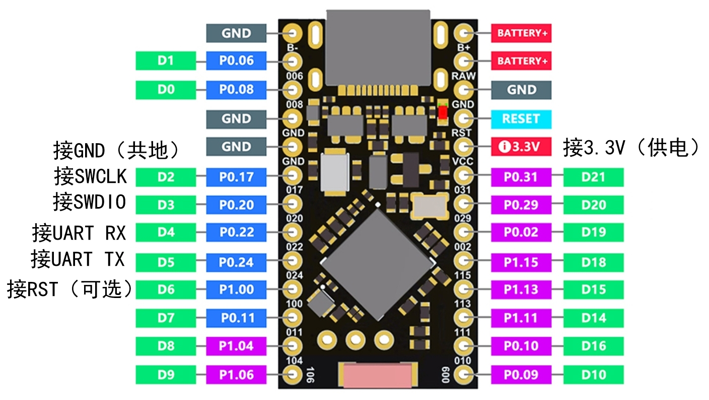

# nRF52840 Wireless CMSIS-DAP v2 + CDC UART (`v7.1.0`)

[](LICENSE)
[](tests/)
[](firmware/)

使用两块 SuperMini / ProMicro（nice!nano 兼容）**Nordic nRF52840** 开发板实现的**对等有线 / 无线二合一 CMSIS-DAP v2.1.2 调试器**与**全双工无线虚拟串口（CDC ACM UART）**。

两块开发板刷入**完全相同的单固件**即可自动协商主从角色；单板直连电脑与目标板时自动走有线高速 `SPIM3` 模式，双板无线配对后走 2.4 GHz 私有低延迟流水线，真正即插即用。

---

## 🌟 核心特性与技术亮点 (`v7.1.0`)

* **左高速射频隔离排针（`LEFT_HS` 默认主力 + `RIGHT_LP` 兼容切换）**：将全部 SWD / UART 高频信号迁出射频与晶振耦合区，实测无线烧录 480 KB 固件 **26,262 帧 `0.00%` 空口重传、零失败**；同时支持通过 `WirelessDAP_Tool.exe` 或 `CONFIG.TXT` 热切换为老版右排针（`RIGHT_LP`）。
* **无线吞吐全面领先**：`240B` 净荷 × `6` 槽位无线空口流水线，在 `STM32F411CEUx`（`@5MHz` SWD）实测 64KB SRAM 写入 **`96.85 KB/s`**、读取 **`85.11 KB/s`**、480KB 校验 **`84.84 KB/s`**、480KB 整片烧录 **`34.762s`**。
* **有线硬件 `SPIM3` 加速 + `SWD_10M` 双策略可选（`8M` 默认 / `16M` 超频）**：有线 `1024B × 8` 流式封包；Keil 选择 `10MHz` 时默认跑 `8MHz` 稳态（兼顾长线与扩展板，480KB 综合速率达 `16MHz` 的 `95.1%`），也可一键切至 `16MHz` 超频（SRAM 读取 **`228.50 KB/s`**、480KB 校验 **`231.75 KB/s`**、整片耗时 **`19.857s`**）。
* **无线全双工串口 32KB 流控 + USB `NAK` 硬背压零丢包**：实测 **`2400 ~ 1,000,000 bps`**（14 档）双向零误码；`64KB @1M` 无流控死灌下行 **`76.50 KB/s`** / 上行 **`67.47 KB/s`**（USB-USB 下行 `86.59` / 上行 `69.91 KB/s`，峰值 `118.27 KB/s`），45 秒 `@460800 + SWD` 高负载混合烤机 **23,116 帧（1.48 MB）零坏包、零缺口、RF 零重传**。
* **`RF_PHY` 双速率自适应（`AUTO` / `1M` / `2M`）+ `AFH` 自适应跳频**：`AUTO` 模式近距使用 `2 Mbps` 满速传输，弱信号自动降速 `1 Mbps` 抗衰减；遭遇同频干扰时支持信道扫描与自动跳频。
* **免接 `NRST` 兼容 `Reset and Run`**：即使未接硬件复位线，也可自动识别 Keil 下载结束脉冲序列并触发 4 线 SWD `SYSRESETREQ`。
* **免驱即用 + 独立遥测控制台 [`WirelessDAP_Tool.exe`](tools/WirelessDAP_Tool.exe)**：内置 MS OS 2.0 描述符（Windows 10/11 免驱）；虚拟 U 盘 `DAPCFG` 内含 `CONFIG.TXT`（双槽位 Flash 持久化）与免安装 GUI 工具，支持实时遥测、频谱扫描、对频同步及**一键进入 Bootloader**（亦支持串口 `1200 bps` 维持 `>= 60 ms` 自动进入 Bootloader）。

---

## 🔌 硬件引脚定义与接线

### 主力推荐：`LEFT_HS`（左侧高速射频隔离排针，默认）



| 信号 | nRF52840 引脚 | 丝印参考 | 目标单片机连接 | 说明 |
| :--- | :---: | :---: | :--- | :--- |
| **`GND`** | `GND` | 左侧 `B-` / `GND` | **`GND`** | **必须共地** |
| **`SWCLK`** | **`P0.17`** | 左侧 `017`（`D2`） | **`SWCLK`** | `SPIM3` 高速时钟（有线支持 8M / 16M） |
| **`SWDIO`** | **`P0.20`** | 左侧 `020`（`D3`） | **`SWDIO`** | SWD 双向数据线（内部上拉） |
| **`UART TX`** | **`P0.22`** | 左侧 `022`（`D4`） | **`UART RX`** | 探针发送 -> 接目标板 `RX` |
| **`UART RX`** | **`P0.24`** | 左侧 `024`（`D5`） | **`UART TX`** | 探针接收 <- 接目标板 `TX` |
| **`NRST`** | **`P1.00`** | 左侧 `100`（`D6`） | **`nRESET`**（可选） | 开漏硬件复位；不接亦支持 SWD 软复位 |
| **`3.3V`** | `VCC` | 右侧 `VCC` | `3.3V` | 仅在目标板无独立供电时对外/反向取电 |

> **备用兼容方案 `RIGHT_LP`**：沿用旧版右侧引脚（`SWCLK=P0.31`、`SWDIO=P0.29`、`UART_TX=P0.02`、`UART_RX=P1.15`、`NRST=P1.13`）的用户，可在 [`WirelessDAP_Tool.exe`](tools/WirelessDAP_Tool.exe) 或 `CONFIG.TXT` 中设置 `PIN_MODE=RIGHT_LP` 直接兼容（详图见 [docs/USAGE.md](docs/USAGE.md)）。
>
> **⚠️ 接线与供电提醒**：所有 GPIO 均为 **3.3V 电平**，严禁直连 5V 信号；右侧 `GND` 与 `VCC` 之间的 `RST` 为 nRF52840 芯片自身复位脚，勿接目标板复位线。

---

## 📊 实测性能对比（`STM32F411CEUx` · 零校验错误）

完整原始数据与无线串口压测记录见 [docs/DAPLink_Wired_Wireless_Benchmark_v7.1.0.xlsx](docs/DAPLink_Wired_Wireless_Benchmark_v7.1.0.xlsx)：

### 1. 无线调试实测对比（`@5MHz` SWD，近距离无遮挡）

| 测试指标 | Horco 无线成品 | 自研 `LEFT_HS`（主力） | 自研 `RIGHT_LP`（备用） |
| :--- | :---: | :---: | :---: |
| 64KB SRAM 写入 | `73.87 KB/s` | **`96.85 KB/s`**（`+31.1%`） | `38.35 KB/s` |
| 64KB SRAM 读取 | `76.23 KB/s` | **`85.11 KB/s`**（`+11.6%`） | `37.55 KB/s` |
| 480KB 大固件校验 | `71.02 KB/s` | **`84.84 KB/s`**（`+19.5%`） | `38.07 KB/s` |
| 480KB 整片总耗时 / 综合速率 | `33.283 s`（`14.42 KB/s`） | `34.762 s`（`13.81 KB/s`） | `49.268 s`（`9.74 KB/s`） |
| 480KB 空口重传率 | — | **`0.00%`**（26,262 帧零重传） | `20.71%` |

### 2. 有线直连实测对比（`LEFT_HS` · `SPIM3` + `1024B × 8`）

| 测试指标 | `5 MHz` | `10M → 8MHz`（默认稳态） | `10M → 16MHz`（超频） |
| :--- | :---: | :---: | :---: |
| 64KB SRAM 写入 | `131.29 KB/s` | `173.54 KB/s` | **`202.54 KB/s`** |
| 64KB SRAM 读取 | `146.39 KB/s` | `196.86 KB/s` | **`228.50 KB/s`** |
| 480KB 大固件校验 | `144.14 KB/s` | `196.02 KB/s` | **`231.75 KB/s`** |
| 480KB 整片总耗时 / 综合速率 | `23.027 s`（`20.84 KB/s`） | `20.883 s`（`22.99 KB/s`） | **`19.857 s`（`24.17 KB/s`**） |

### 3. 无线全双工串口与稳定性烤机
* **波特率全覆盖**：`2400 ~ 1,000,000 bps` 14 档双向零误码全量通过。
* **64KB 死灌与背压**：`@1M` 实机死灌上行 **`67.47 KB/s`** / 下行 **`76.50 KB/s`**（`115200` 下 `64KB` 背压 `10.98 KB/s` 零丢包）。
* **45s 高负载混合烤机**：`@460800` 连续流 + 16 轮 16KB SWD 并发，实收 23,116 帧 / 1.48 MB，**0 坏包、0 缺口、RF 0 重传**；实车 512KB 固件 `9.536s` 还原并通过 `SHA-256` 校验。

---

## 🚀 极速上手：拖拽刷入固件 (UF2)

* **最新稳定版固件**：[`firmware/wireless_daplink_v7.1.0_hs_pins.uf2`](firmware/wireless_daplink_v7.1.0_hs_pins.uf2)（`540,160 bytes`）
* **SHA-256**：`00D69192234DC57CEF55F2A0B8B0365F9FC14F029E3C3FB0112684A50A26E2ED`

### 刷录步骤：
1. 用 USB 数据线将 nRF52840 开发板连接至电脑。
2. **0.5 秒内快速短接两次 `RST` 与 `GND`**（或双击板载 `RST` 按键），弹出 `NICENANO` 或 `NRF52BOOT` 磁盘。
3. 将 `wireless_daplink_v7.1.0_hs_pins.uf2` 拖入该磁盘，等待自动烧写并重启。
4. **两块开发板请刷入同一版本固件**，并搭配 [`tools/WirelessDAP_Tool.exe`](tools/WirelessDAP_Tool.exe) 配置使用。

---

## 🛠️ 免驱配置与内置上位机

### 方式一：图形控制台 [`tools/WirelessDAP_Tool.exe`](tools/WirelessDAP_Tool.exe)（推荐）
直接双击打开虚拟磁盘中或仓库 [`tools/WirelessDAP_Tool.exe`](tools/WirelessDAP_Tool.exe)（免安装单文件，无外部 DLL 依赖），即可实时查看链路健康遥测、扫描干净信道、同步配对参数、切换 `PIN_MODE` / `RF_PHY` / `SWD_10M` / `ROLE` 以及**一键进入 Bootloader**。

### 方式二：文本修改 `CONFIG.TXT`
打开虚拟磁盘 `DAPCFG` 中的 `CONFIG.TXT` 修改并保存（`Ctrl+S`）即可实时写入双槽位 Flash：

| 参数 | 取值范围 | 默认值 | 说明 |
| :--- | :--- | :---: | :--- |
| `PAIR_CODE` | 1..15 位 ASCII | `123456` | 配对码（两端须一致） |
| `CHANNEL` | `0..100` | `80` | 射频频点（`2400 + CHANNEL` MHz） |
| `TX_POWER` | `8, 4, 0, -4, -8, -12, -16, -20` | `8` | 发射功率（dBm） |
| `ROLE` | `AUTO` / `TX` / `RX` | `AUTO` | 角色模式（`AUTO` 自动协商 / 固定主从） |
| `UART_BAUD` | `9600..1000000` | `115200` | 无 PC 串口连接时的默认透传波特率 |
| `AUTO_HOP` | `1` / `0` | `1` | 高干扰自动跳频开关 |
| `RF_PHY` | `AUTO` / `1M` / `2M` | `AUTO` | 射频速率（`AUTO` 近距 2M / 弱信号切 1M） |
| `PIN_MODE` | `LEFT_HS` / `RIGHT_LP` | `LEFT_HS` | 引脚配置方案 |
| `SWD_10M` | `8M` / `16M` | `8M` | Keil 选 `10MHz` 时有线 SWD 频率映射 |

---

## 💻 源码构建与单元测试

```powershell
.\run_tests.ps1
.\build.ps1
```

---

## 📚 详细文档导航

* [接线与 Keil MDK 详细配置指南](docs/USAGE.md)
* [预编译固件清单与 SHA-256 校验](firmware/README.md)
* [有线与无线实测性能对比表](docs/DAPLink_Wired_Wireless_Benchmark_v7.1.0.xlsx)
* [源码构建与编译选项说明](docs/BUILD.md)
* [核心架构与协议设计](docs/DEVELOPMENT.md)
* [测试与工程验证方法](docs/VALIDATION.md)

---

## 📄 开源许可证

本项目遵循仓库根目录 [LICENSE](LICENSE) 许可协议。CMSIS-DAP 协议层版权归 ARM 所有。
