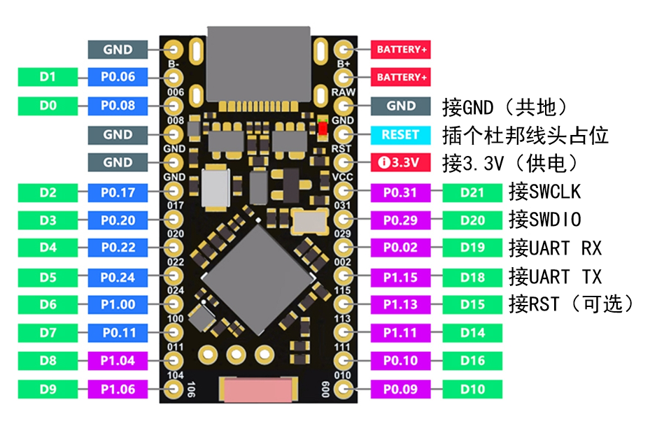
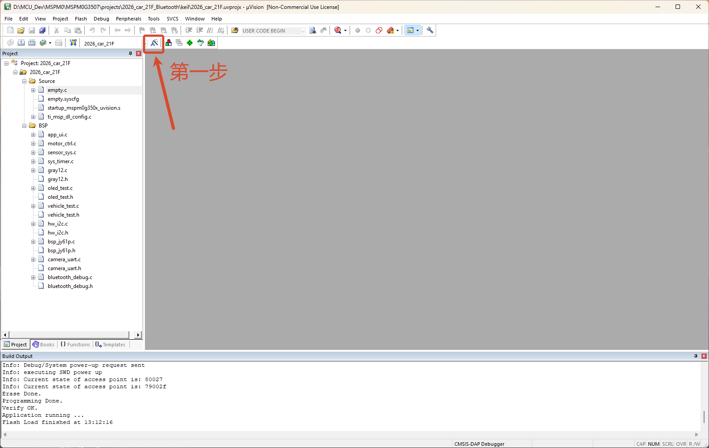
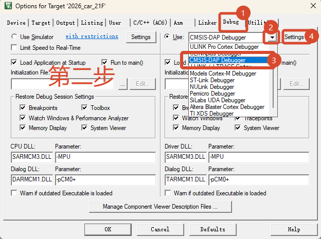
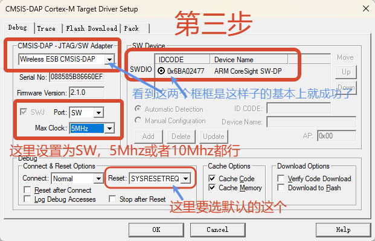
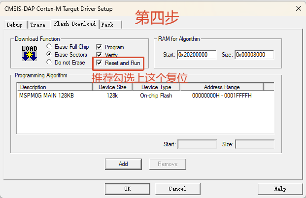

# 接线和使用

两板运行同一固件，不绑定板子序列号（A 端接目标单片机，B 端接电脑，两块板可随时互换用途）。目标检测在启动与USB重新接入时进行；需先接线并给目标供电，然后重启或重新接USB。没有电、锁定或不响应SWD的目标不能保证被自动检测到。

## 一、引脚定义与接线

| 芯片GPIO | 功能 | 接目标 |
|---|---|---|
| P0.31 | SWCLK | SWCLK |
| P0.29 | SWDIO | SWDIO |
| GND | 共地 | GND（必须共地） |
| P0.02 | UART TX | UART RX（需要串口时接） |
| P1.15 | UART RX | UART TX（需要串口时接） |
| P1.13 | 可选目标复位 | nRESET/NRST（普通使用可不接） |

当前按3.3V目标使用，没有目标电压检测与电平转换，不要直接接5V信号。两侧串口交叉连接、共地。SWD至少连接CLK/DIO/GND；未接目标复位线时使用SWD软件复位。板载RST属于探针本身。

## 二、烧录探针固件方法（进入 UF2 Bootloader）

默认出厂内置程序通常是 Blink-All-IO（所有 IO 口 1s 自动翻转）。刷入本固件步骤如下：

1. 用带数据功能的 USB 线将 nRF52840 的 USB 口接到电脑上。
2. **0.5 秒内短接两次 `RST` 到 `GND`**（可以在 `RST` 孔插一根杜邦线头占位方便触碰；带按键的板子直接在 0.5 秒内按两次 `RST` 按键即可）。
3. 电脑会识别出一个约 32MB 的可移动磁盘，将同一个 `.uf2` 固件分别复制到两块板的磁盘中。
4. 复制完成后自动重启（或断电重启），即可使用。

## 三、有线烧录、无线烧录与模式切换

### 1. 有线烧录（单板直连）
1. 接好目标 SWD 和 GND，给目标供电。
2. 用 USB 数据线将接目标的 nRF52840 板（A 端）直接连接电脑。
3. Keil 选择 `CMSIS-DAP Debugger`，在 Settings 中选择这块板的探针（USB VID:PID `239A:80E2`，两个物理板序列号不同）。
4. `Port` 选择 `SW`，`Max Clock` 选 `5 MHz`（固件限制请求到 4 MHz；实际输出波形需测量）。
5. 确认 `Flash Download` 中有正确的芯片算法并勾选 `Reset and Run`，点击 Download。

### 2. 无线烧录（双板无线）
1. **A 端（目标端）**：接好目标 SWD/UART，A 端和目标正常供电；**A 端不插电脑 USB，使用独立电源（3.3V 引脚供电）**。
2. **B 端（电脑端）**：用 USB 数据线连接电脑，等待两端自动握手连接（配对灯常亮仅代表协议握手完成，不能代替目标识别/烧录验证）。
3. Keil 选择 B 端探针，`Port` 选 `SW`、`Max Clock` 选 `5 MHz`，再点击 Download。

### 3. 有线 / 无线切换与供电注意
- **无线转有线**：A 端插电脑 USB（目标端插电脑时有线优先，电脑端整个 USB 复合设备会隐藏），Keil 改选 A 端探针。
- **有线转无线**：拔掉 A 端 USB，保持 A 端独立供电，等待连接后 Keil 改选 B 端探针。切换后 Keil / COM 句柄可能需要重新选择或打开。
- **交换两块板用途**：先接好目标并给目标供电，再重插 USB 或重启 nRF 板。
- **重要避坑**：无线使用时，**不要用 A 端 USB 口接手机充电头供电**，否则可能误检测 USB 状态进入本地有线模式。
- **排错提示**：USB 线必须能传数据。若 Keil 找不到目标，先检查供电、共地和 SWD 接线，再将时钟降到 `1 MHz` 测试；一般偶发通信出错时，重新插拔重启一下 B 端即可恢复。

## 四、Keil MDK 配置图文步骤（与普通 DAPLink 一致）

### 第 1 步：打开魔术棒（Options for Target）

### 第 2 步：在 Debug 页选择 CMSIS-DAP Debugger 并点击 Settings

### 第 3 步：确认识别到 Wireless ESB CMSIS-DAP 与目标芯片 IDCODE
选择 `Port: SW`，`Max Clock` 选 `5MHz`（或 `10MHz`），`Reset` 保持默认 `SYSRESETREQ`：

### 第 4 步：在 Flash Download 页勾选 Reset and Run

## 五、串口（CDC UART）使用与限制

有线时打开 A 端 COM 口；无线时打开 B 端 COM 口（COM 号以设备管理器为准）。P0.02 接目标 RX，P1.15 接目标 TX，必须共地。

UART冷启动115200/8N1。支持1200、2400、4800、9600、14400、19200、28800、31250、38400、56000、57600、76800、115200、230400、250000、460800、921600、1000000及8N1/8N2/8E1/8E2。配置支持不代表全部档位已实测通过，也不代表无线持续满速无损。

奇校验、7数据位和1.5停止位不支持，无效设置保留上一配置。修改参数前停止收发，等待无线设置应答再继续。DTR/RTS不复位目标；CDC端点就绪即可回传，无需DTR拉高。禁用正常1200波特率关闭COM触发DFU，仍可双击Reset进入UF2。

没有RTS/CTS流控。无线断线、输入长期超过空口能力或主机不读数据时可能丢字节；USB镜像缓存为尽力转发。通信内容没有认证、绑定或加密，不应把该原型用于受保护目标的开放环境。该协议不支持手机蓝牙配对。

使用前以同一目标/工程先测有线，再测近距无线；连续多次烧录、双向UART序号/CRC及UART加烧录并发，随后测距离、恢复、USB切换和长时间待机。
