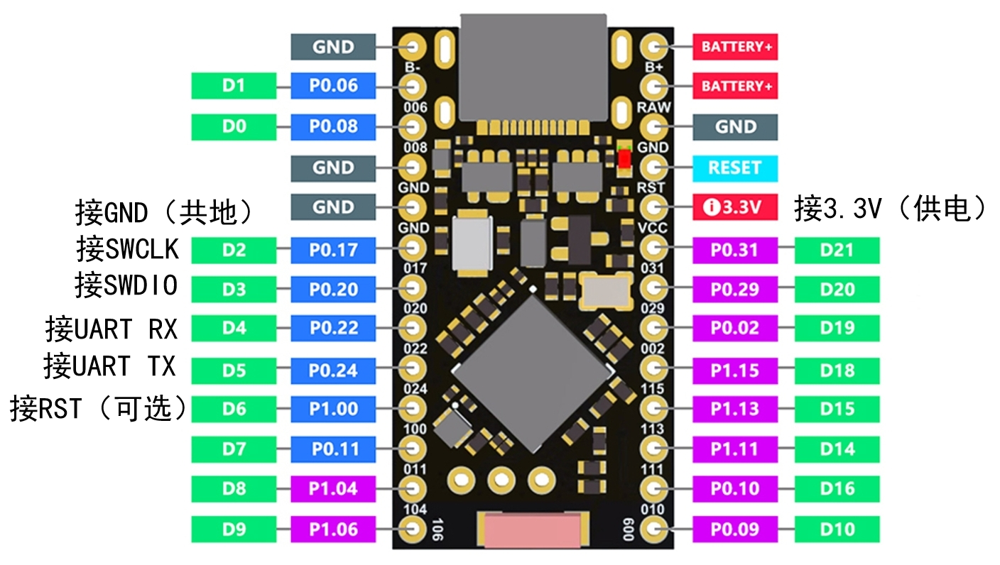
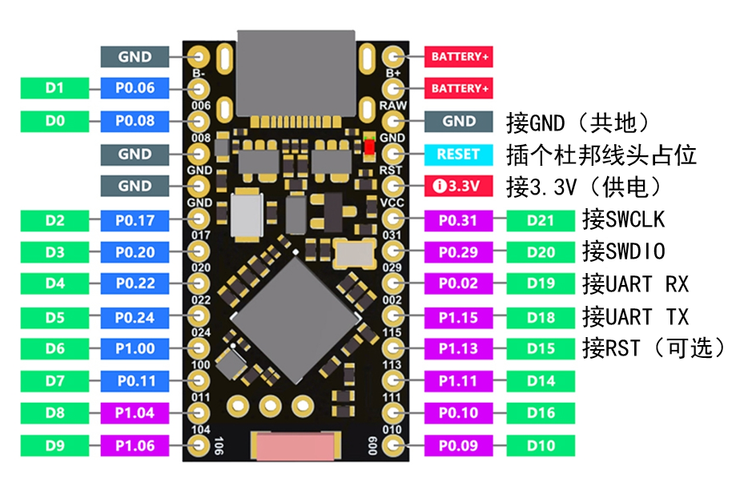
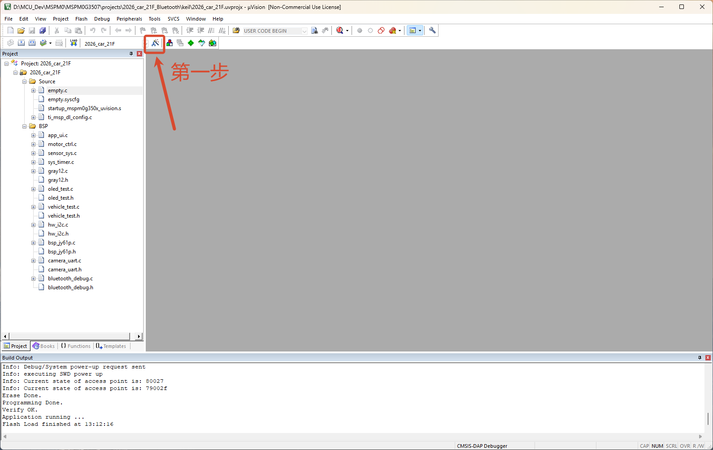
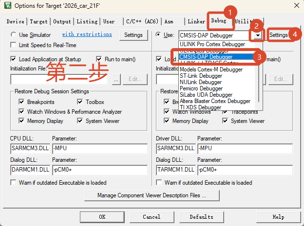
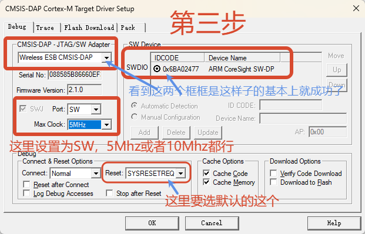
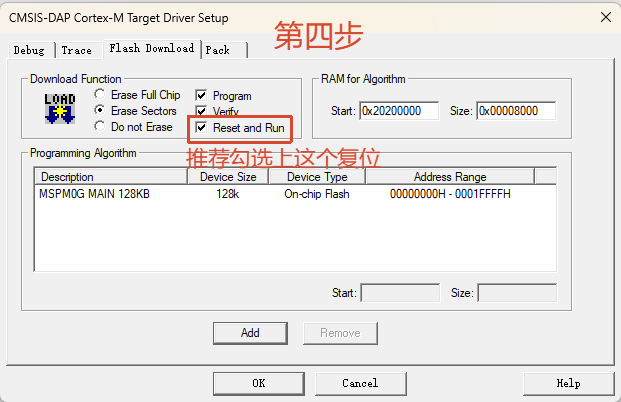

# 接线与使用详细教程 (`v7.1.1`)

本项目采用**对等单固件设计**，两块 nRF52840 开发板刷入完全相同的固件即可协同工作，不绑定硬件序列号（目标端接目标单片机，主机端插电脑 USB，两块板可互换角色，也可设为固定 `TX`/`RX`）。

---

## 一、引脚定义与硬件接线

### 1. 默认推荐：左高速射频隔离引脚（`LEFT_HS`，出厂默认）



| nRF52840 引脚 | 丝印参考 | 功能 | 接目标单片机 | 说明 |
|:---|:---:|:---|:---|:---|
| **`GND`** | 左侧 `B-` / `GND` | 信号地 | `GND` | **必须与目标芯片共地** |
| **`P0.17`** | 左侧 `017`（`D2`） | SWCLK | `SWCLK` | `SPIM3` 高速时钟输出（有线支持 8M / 16M） |
| **`P0.20`** | 左侧 `020`（`D3`） | SWDIO | `SWDIO` | SWD 双向数据线（内部上拉） |
| **`P0.22`** | 左侧 `022`（`D4`） | UART TX | `UART RX` | 探针发送 -> 接目标板串口 RX |
| **`P0.24`** | 左侧 `024`（`D5`） | UART RX | `UART TX` | 探针接收 <- 接目标板串口 TX |
| **`P1.00`** | 左侧 `100`（`D6`） | 目标复位 | `nRESET / NRST` | 目标硬件开漏复位（可选；不接亦支持 SWD 软复位） |
| **`VCC`** | 右侧 `VCC` | 3.3V 电源 | `3.3V` | 支持对目标供电或目标反向供 `3.3V`（勿与外部 `3.3V` 对接） |

### 2. 备用兼容：右排针引脚（`RIGHT_LP`）



仍沿用右侧排针接线（`SWCLK=P0.31/031`、`SWDIO=P0.29/029`、`UART_TX=P0.02/002`、`UART_RX=P1.15/115`、`NRST=P1.13/113`）的用户，刷入固件后在 `WirelessDAP_Tool.exe` 或 `CONFIG.TXT` 中设置 `PIN_MODE=RIGHT_LP` 即可直接兼容（未激活组引脚自动设为高阻断开）。

### ⚠️ 接线要点与避坑指南

1. **电平标准**：所有 IO 信号均为 **3.3V TTL 电平**，严禁直接连接 5V 单片机信号脚。
2. **关于板载 `RST` 孔位**：开发板右侧排针中夹在 `GND` 和 `VCC` 之间的 `RST` 孔位是 **nRF52840 芯片自身的复位引脚**，**绝不能接到目标单片机上**。
3. **目标端供电支持智能识别**：无线模式下，目标端支持通过 `3.3V` 引脚或 **Type-C 接口插充电头/充电宝供电**（仅供电不枚举不会误入本地有线模式）；若直接插电脑 USB 且检测到本地目标连接，则会无缝切换为本地有线高速调试器。
4. **免接 `NRST` 兼容**：即使不接 `P1.00` 复位线，在 Keil 勾选 `Reset and Run` 下载结束时，固件会自动识别序列并触发 4 线 SWD 内核软复位 `SYSRESETREQ`。

---

## 二、刷入探针 UF2 固件

1. 用带数据传输功能的 Type-C 数据线将开发板连接到电脑。
2. **0.5 秒内快速短接两次 `RST` 与 `GND`**（或双击物理 `RST` 按钮）。
3. 开发板进入 Bootloader 模式，电脑会弹出名为 `NICENANO` 或 `NRF52BOOT` 的可移动磁盘。
4. 将仓库 [`firmware/wireless_daplink_v7.1.1_hs_pins.uf2`](../firmware/wireless_daplink_v7.1.1_hs_pins.uf2) 直接拖拽复制到该磁盘中，开发板会自动完成刷写并重启。
5. **两块开发板均按此步骤刷入同一份固件！**
6. 后续升级固件可在 `WirelessDAP_Tool.exe` 点击**一键进入 Bootloader**，或用串口助手以 **`1200 bps`** 打开虚拟串口并维持 `>= 60 ms` 自动进入 Bootloader。

---

## 三、免驱虚拟配置盘 (`DAPCFG`) 与 GUI 上位机 (`WirelessDAP_Tool.exe`)

将主机端插入电脑 USB 后，Windows 10/11 免驱自动枚举为 CMSIS-DAP v2、USB CDC 串口、Telemetry WinUSB 与虚拟 U 盘 `DAPCFG`：

### 1. 使用配套图形控制台 (`WirelessDAP_Tool.exe`)
在虚拟 U 盘根目录或仓库 [`tools/WirelessDAP_Tool.exe`](../tools/WirelessDAP_Tool.exe) 直接双击运行（免安装单文件，无第三方 DLL 依赖）：
* **实时状态与健康遥测**：查看主/从端连接状态、`RSSI`、空口 `RTT`、重发率、自适应信道/PHY 状态、当前波特率及流控队列统计。
* **信道扫描与对频同步**：支持扫描 2.4 GHz 频段底噪并一键推荐最干净信道，支持从主机端一键同步配置到无线对端。
* **关键参数切换**：
  - `PAIR_CODE`（配对码，1..15 位 ASCII，两端须一致）
  - `CHANNEL`（0..100，默认 80 即 2480 MHz）
  - `TX_POWER`（`8, 4, 0, -4, -8, -12, -16, -20` dBm，默认 `8`）
  - `ROLE`（`AUTO` / `TX` / `RX`）
  - `RF_PHY`（`AUTO` 近距 2M/弱信号切 1M | `1M` 远距 | `2M` 极速）
  - `PIN_MODE`（`LEFT_HS` 默认左排针 | `RIGHT_LP` 右排针兼容）
  - `SWD_10M`（`8M` 默认稳态 | `16M` `LEFT_HS` 有线超频）
  - `AUTO_HOP`（`1` 开启自动跳频 | `0` 关闭）

### 2. 文本化配置 (`CONFIG.TXT`)
也可直接用记事本打开虚拟磁盘中的 `CONFIG.TXT` 修改后保存（`Ctrl+S`），固件将自动校验并持久化写入双槽位片上 Flash：
```ini
PAIR_CODE=123456
CHANNEL=80
TX_POWER=8
ROLE=AUTO
UART_BAUD=115200
AUTO_HOP=1
RF_PHY=AUTO
PIN_MODE=LEFT_HS
SWD_10M=8M
```

---

## 四、LED 状态指示说明

| LED 状态 | 含义 | 说明 |
|:---|:---|:---|
| **慢闪** | 搜索配对中 | 正在寻找同配对码与信道的对端设备 |
| **常亮** | 链路已就绪 | 主从已建立高速 2.4G 链路或本地有线就绪 |
| **高频闪烁 (10 Hz)** | SWD / 串口活跃 | 正在执行固件下载、调试或串口数据收发 |

---

## 五、Keil MDK 详细配置图文步骤

### 第 1 步：点击魔术棒打开 Options for Target


### 第 2 步：切换到 Debug 标签页，选择 CMSIS-DAP Debugger 并点击 Settings


### 第 3 步：确认识别到 CMSIS-DAP v2 及 SW Device (IDCODE)
* 将左侧设置为 `Port: SW`，`Max Clock` 可选 `5MHz` 或 `10MHz`（有线模式下 `10MHz` 将按 `SWD_10M` 策略运行在 `8MHz` 稳态或 `16MHz` 超频）。
* 下方 `Reset` 建议选择 `SYSRESETREQ`：


### 第 4 步：切换到 Flash Download 标签页，勾选 Reset and Run


---

## 六、无线全双工串口 (CDC UART) 使用说明

* **支持波特率范围**：实测支持 **`2400 ~ 1,000,000 bps`**（14 档常用波特率双向零误码通过；最高支持 `1,000,000 bps`）。
* **波特率自动同步**：主机端连接电脑更改串口波特率时，自动通过空口帧头同步对端硬件 `UARTE0` 波特率；双板纯串口脱机透传时，建议固定 `TX` / `RX` 角色并在 `CONFIG.TXT` 预先配置相同的 `UART_BAUD`。
* **零丢包背压流控**：内置 `32 KB` 环形缓冲与 USB CDC `NAK` 硬背压机制，支持高密并发打印与 `SWD + UART` 混合负载运行。
